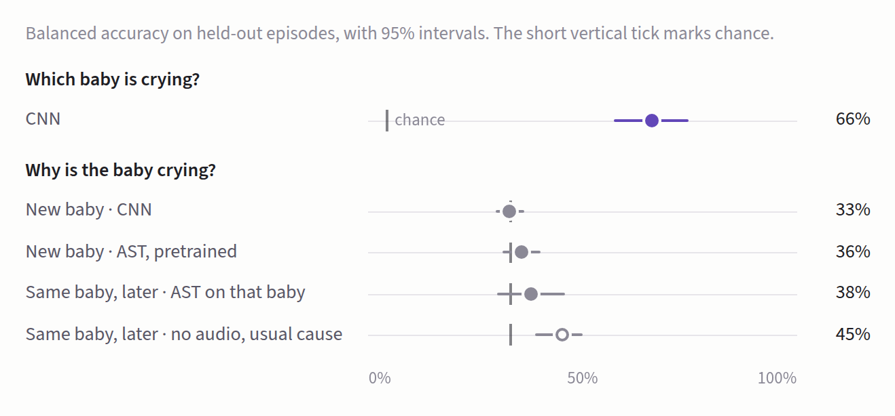

# Baby cry translator: method and full results

Predicts why a baby is crying (hunger, discomfort, loneliness) from a log-mel spectrogram, with a small CNN. Tested on babies the model has never heard.

**On new babies, every model names the cause at chance. The same CNN names the baby 66% of the time.**



## Data

Lockhart-Bouron et al. 2023, [OSF ru7na](https://osf.io/ru7na/). 39,201 cries, 612 crying episodes, 24 babies aged 0.5 to 3.5 months, recorded at home. OSF lists no licence, so this repo never contains the audio; `src/prep.py` expects it under `data/raw/enes/`.

| Cause | Cries | Episodes | Babies |
|---|---|---|---|
| Loneliness | 15,609 | 193 | 24 |
| Hunger | 13,095 | 255 | 23 |
| Discomfort | 10,497 | 164 | 23 |

Two shortcuts a model could take instead of hearing the cause:

| | Hunger share of episodes |
|---|---|
| Age 0.5 months | 53% |
| Age 3.5 months | 33% |
| Night (22:00 to 07:00) | 54% |
| Day | 37% |

Cries also sound different as babies age, so a model could beat chance by hearing age. The age-only baseline and the within-group scores below check for this.

## Plan, fixed before any CNN result

This file was committed before the first CNN was trained. Any change made after seeing results will be listed under "Changes after results", with a date.

**Main question.** On babies it has never heard (split B), does the CNN name the cause better than chance?

**Pass mark.** Yes only if the whole 95% interval of its balanced accuracy is above 33%, and it beats the age-only baseline.

## Models

| # | Model | Question it answers |
|---|---|---|
| 1 | Majority class (always "hunger") | Reference line |
| 2 | Age-only lookup (most common cause at that age) | How far does hearing age get you? |
| 3 | Baby-only lookup (split A only) | How far does knowing the baby get you? |
| 4 | Random forest on the paper's 10 acoustic features | The paper's method on our splits |
| 5 | CNN on log-mel spectrograms | The main model |
| 6 | CNN, standardised per baby | Does cause survive once identity is removed? |
| 7 | AST (Audio Spectrogram Transformer, pretrained on AudioSet, which includes baby cries), frozen; logistic regression on its 768-number embedding, strong fixed regularisation (C = 0.01, no tuning) | Is the CNN limited by having only 612 episodes? |
| 8 | Same CNN, trained to tell the 24 babies' recordings apart | Positive control: can this pipeline learn anything from these spectrograms? It may use each home's background sound as well as the voice. |

Models 1 to 3 are counting rules with no training.

## Settings

### Data
| Setting | Choice | Why |
|---|---|---|
| Label | Action that stopped the cry | Less of a guess than the parent's belief (they agree in 83% of episodes) |
| Classes | Hunger, discomfort, loneliness | Pain (95 cries) and "other" (76) are too few; "don't know" has no label |
| Prediction unit | Episode, averaged over its cries | What a parent actually hears |

### Audio
| Setting | Choice | Why |
|---|---|---|
| Sample rate | 16 kHz | Keeps everything up to 8 kHz, where cry harmonics fade |
| Filter | 100 Hz high-pass, done by the authors | No need to repeat |
| Length | 1.5 s | Covers about 90% of cries whole |
| Short cries | Padded with silence | Silence adds no false signal |
| Long cries | Random 1.5 s window in training; sliding 1.5 s windows (half overlap) in testing, averaged | Every part of a long cry gets scored |

### Spectrogram
| Setting | Choice | Why |
|---|---|---|
| Window | Hann | Lowest leakage between harmonics on a log scale |
| Window length | 512 samples (32 ms) | 31 Hz bins resolve harmonics about 350 Hz apart |
| Hop | 160 samples (10 ms) | Follows pitch changes; standard for speech |
| Mel bands | 64, from 100 Hz to 8 kHz | Common middle ground; matches the filter |
| Decibels | Relative to the loudest point of the whole episode, 80 dB floor | Keeps loudness changes within an episode; removes mic distance, which changes between episodes |
| Standardise | Mean and spread per band, from training babies only | Test babies stay unseen |
| Input shape | 1 x 64 x 151 | One channel, 64 bands, 151 frames |

### Augmentation (training only)
| Setting | Choice | Why |
|---|---|---|
| Frequency masks | 2, up to 8 bands each | Stops reliance on one narrow band |
| Time masks | 2, up to 20 frames each | Stops reliance on one moment |
| Pitch shift | Off | Pitch may be the very signal |

### Model
| Setting | Choice | Why |
|---|---|---|
| Blocks | 4 x (3x3 conv, batch norm, ReLU, 2x2 max-pool) | Enough depth for a 64 x 151 picture |
| Channels | 16, 32, 64, 128 | About 100k weights; 612 episodes can't support more |
| Head | Global average pool, dropout 0.3, linear to 3 | Same answer wherever the cry sits in time |

### Training
| Setting | Choice | Why |
|---|---|---|
| Loss | Cross-entropy, class-weighted | Hunger has 255 episodes, discomfort 164 |
| Cries per episode per epoch | Up to 32, drawn at random | Each episode counts about equally |
| Optimiser | AdamW, learning rate 0.001, weight decay 0.0001 | Works without tuning; weight decay fights overfitting |
| Schedule | Cosine decay, 30 epochs | Smooth finish without tuning |
| Batch size | 64 | Stable batch norm |
| Early stopping | Best balanced accuracy on validation babies | Validation babies sit outside training |
| Seeds | 3 per fold | Results on 612 episodes swing between seeds |
| Hardware | RTX 5060 laptop GPU | A fold takes minutes |

### Evaluation
| Setting | Choice | Why |
|---|---|---|
| Split A | Paper's: by episode, 66/34 per cause, 5 repeats; same babies on both sides | Direct comparison with their 36% |
| Split B | By baby: 6 folds, 16 train, 4 validation, 4 test babies | The honest test for a new family |
| Main metric | Balanced accuracy per episode, all folds pooled; chance is 33% | Fair across unequal classes |
| Also reported | Recall per class | Shows which causes get confused |
| Uncertainty | 95% interval from resampling babies 2,000 times | Babies are the independent units |
| Comparisons | Paired: the same resampled babies for both models | Removes baby-to-baby noise from the difference |
| Shortcut checks | Age-only baseline; scores within each age and within day and night | Catches a model that hears age or time of day |
| Per-baby standardisation | From the same baby's other episodes, never the one being scored | An app would calibrate on earlier cries |

## Run

```bash
python src/prep.py                                   # spectrograms and splits (about 4 min on CPU)
python src/train.py --split B                        # 6 folds x 3 seeds
python src/train.py --split A                        # 5 repeats x 3 seeds
python src/train.py --split B --per-baby-norm        # model 6
python src/train.py --task identity                  # model 8
python src/forest.py --split B                       # model 4 (CPU)
python src/ast_probe.py extract && python src/ast_probe.py fit --split B   # model 7
python src/evaluate.py runs/splitB runs/splitB_perbaby runs/forest_splitB runs/ast_splitB
```

## Results (2026-11-12)

**On babies it has never heard, no model names the cause better than chance. The same CNN tells the 24 babies apart at 66%.**

Split B, new babies. Balanced accuracy per episode, 95% interval over babies, chance 33%.

| Model | Score | Interval |
|---|---|---|
| CNN | 32.9% | 29.6 to 36.5 |
| CNN, per-baby standardisation | 32.8% | 28.6 to 37.1 |
| AST, frozen | 35.8% | 31.4 to 40.3 |
| Random forest (paper) | 32.4% | 29.4 to 35.3 |
| Age-only rule | 31.8% | 27.8 to 35.4 |

Split A, the paper's split (same babies in training and test).

| Model | Score | Interval |
|---|---|---|
| Baby-only rule | 40.6% | 34.2 to 45.5 |
| AST, frozen | 37.9% | 34.2 to 41.2 |
| CNN | 35.9% | 31.8 to 39.5 |
| Random forest (paper; they report 36%) | 35.5% | 33.5 to 37.7 |
| Age-only rule | 35.5% | 32.9 to 38.7 |

Positive control: the same CNN naming which of the 24 babies' recordings an episode came from scores 66.3% (57.2 to 74.7); chance is 4.2%.

- The pass mark is not met. The CNN's interval includes 33%, and it does not beat the age-only rule.
- No model beats the age-only rule by a clear margin on either split. On split A, knowing the baby beats every acoustic model.
- The pipeline can learn from these spectrograms (66% on identity), so the weak cause scores point to the cries, not the code. Identity may include each home's background sound.
- CNN seeds on split B scored 34.3%, 35.3% and 29.2% pooled; averaging per fold instead of pooling gives 35%.

## Part 2: a translator that learns your own baby (plan fixed before results, 2026-11-12)

Part 1 found that cries identify the baby far better than the cause. Part 2 asks whether a model that has heard one baby's earlier, labelled episodes can name the cause of that same baby's later episodes.

**Split C, by time.** Each baby's episodes in recording order: the first two thirds train (the last 15% of those validate the CNN), the rest test. 327 train, 72 validation and 213 test episodes. Every baby is on both sides, and every test episode is later than every training episode of that baby.

| Model | Trained on |
|---|---|
| Majority, age-only | Counting rules |
| Baby-only | That baby's most common cause so far |
| Baby + time of day | That baby's most common cause so far at that time (day or night) |
| CNN, AST, random forest (pooled) | Everyone's earlier episodes |
| AST and random forest, personal | One model per baby, only that baby's earlier episodes |

The two baby lookups are what a parent's own log already tells you, with no audio. Audio has to add something on top.

**Main question.** Does the personal AST model (pretrained features suit a few dozen episodes per baby) beat both baby lookups on later episodes?

**Pass mark.** Its paired 95% interval against each lookup sits fully above zero. The other models are secondary.

The random forest's per-baby scaling uses only the training period here, so no model sees anything from the future. The CNN is not trained per baby; 10 to 30 episodes are too few to train it from scratch.

### Part 2 results (2026-11-12)

**A baby's own history beats every audio model on that baby's later episodes.** Split C, balanced accuracy per episode, 95% interval over babies.

| Model | Score | Interval |
|---|---|---|
| Baby-only lookup (no audio) | 45.4% | 38.8 to 50.1 |
| Baby + time of day (no audio) | 42.3% | 36.2 to 47.7 |
| CNN, pooled | 38.3% | 32.9 to 42.7 |
| AST, personal (main model) | 37.9% | 30.0 to 45.8 |
| Random forest, personal | 36.5% | 29.4 to 43.4 |
| AST, pooled | 34.9% | 29.4 to 41.4 |
| Majority / age-only | 33.3% | |
| Random forest, pooled | 27.4% | 22.5 to 32.7 |

- The pass mark is not met. Personal AST minus baby-only: -7.6 points (-15.0 to +2.5); minus baby + time: -4.5 (-12.0 to +4.8).
- The personal forest is reliably worse than the baby-only lookup: -8.9 points (-15.1 to -2.4).
- The paper's per-baby forest reached 62%. That figure is out-of-bag accuracy on single cries (cause~ac_RF.R, "One baby at a time"), with other cries from the same episode in training, and age as a feature. Scored per episode on later episodes, per-baby models land at 36 to 38%.
- The pooled forest falls below chance. Its per-baby scaling here uses only the training period, and causes shift as babies age.

## Changes after results

None. Every number above uses the plans as committed.
