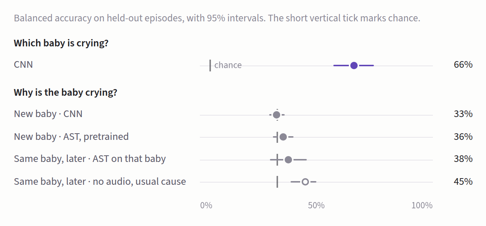

# Baby cry translator

Can a model tell why a baby is crying? Tested on 39,201 cries from 24 babies ([Lockhart-Bouron et al., 2023](https://doi.org/10.1038/s44271-023-00022-z)), labelled hunger, discomfort or loneliness by what stopped the cry.

**On new babies, every model names the cause at chance. The same CNN names the baby 66% of the time.**



| Test | CNN | AST (pretrained) | Without audio | Chance |
|---|---|---|---|---|
| New babies | 32.9% | 35.8% | 31.8% (age only) | 33% |
| Same baby, later episodes | 38.3% | 37.9% (trained on that baby) | 45.4% (that baby's usual cause) | 33% |
| Which baby is crying? | 66.3% | | | 4% |

Balanced accuracy per crying episode. On the paper's own split, the random forest gets 35.5%, in line with their 36%. Their per-baby 62% scores single cries while other cries from the same episode sit in training.

Full plan, settings and results with intervals: [METHOD.md](METHOD.md).

## Run

The audio is on [OSF](https://osf.io/ru7na/) and is not included here. Unzip it into `data/raw/enes/`.

```bash
python src/prep.py                 # spectrograms and splits
python src/train.py --split B      # CNN on new babies
python src/evaluate.py runs/splitB
```
